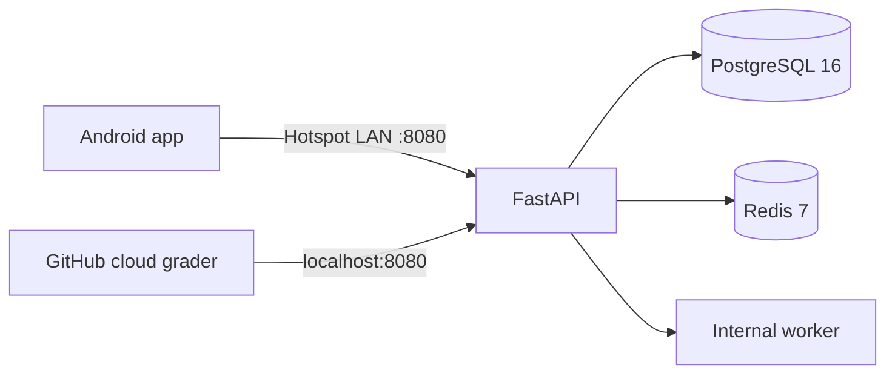
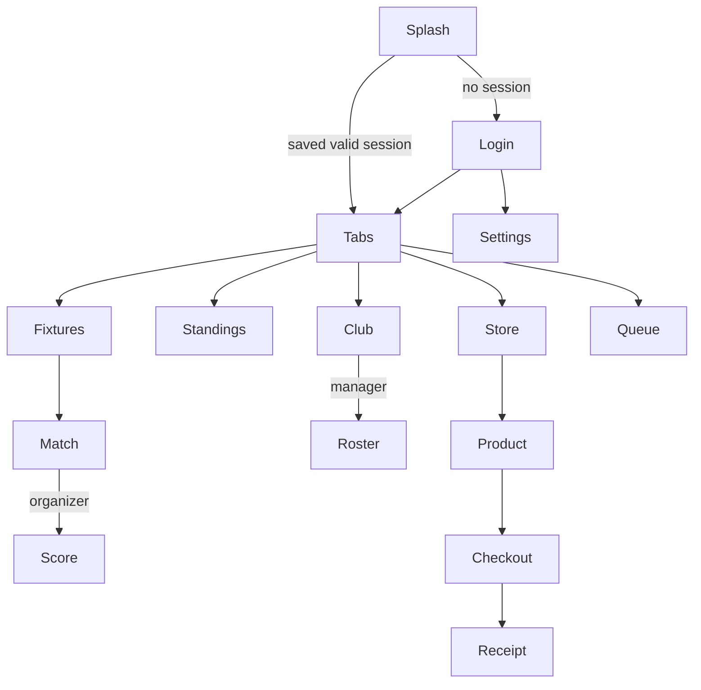

# System design

## Runtime

The backend laptop hosts the API and containers. The Android phone uses its LAN IP, never `localhost`. The cloud grader clones the eligible commit and starts the same Compose topology on Ubuntu. All backend runtime requirements must be declared in Compose; the grader has no access to a teammate's manually installed PostgreSQL.

## Login and role navigation

The top sync bar is visible across screens and opens the queue. Settings changes the server address. The demo app presently uses saved demo identity; the backend login adapter must replace it with a real JWT stored in SecureStore.

## Offline sequence

1. Cache fixtures, standings and club profile in SQLite after a successful read.
2. When offline, create an action with `action_id`, `type`, `queued_at`, `base_version`, and audit-compatible `payload`.
3. Persist it before reporting success in the UI. Force-closing must not erase it.
4. On reconnection, submit up to 100 pending actions to `/audit/v1/offline-sync` in creation order.
5. Show `applied`, `duplicate`, or `rejected` and its reason per action. Do not discard rejected actions without a visible history.

## Checkout and scoring

The mobile app sends a mock gateway token and chosen variant to the backend. PostgreSQL must reserve stock atomically, then authorize/capture the mock payment and produce a signed PDF receipt. The mobile UI displays the backend receipt; the local demo receipt is explicitly marked as unsigned preview data.

The organizer queues or submits scoring events. FastAPI appends immutable events and computes projections from the event stream. A correction appends a compensating event. Every accepted event receives the backend-generated HMAC signature.

## Delivery gates

- Docker Compose starts from a clean Ubuntu checkout, seeds baseline data, and serves `/health` on port 8080.
- The exact audit wrapper is validated against the Part I specification and its reference vectors.
- Android APK installs on API 29+ and is committed at `mobile/release/app-release.apk`.
- Desk check covers standings → match, product → checkout → receipt, and roster offline → restart → sync.
